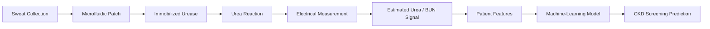
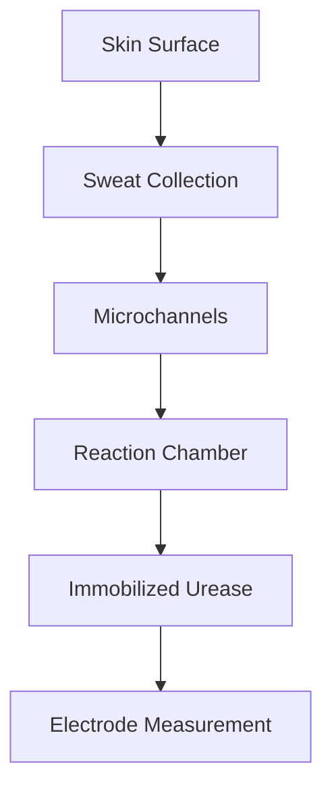
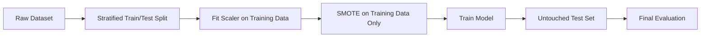

# NephroPatch — Wearable CKD Screening Research Prototype

**NephroPatch** is a research prototype exploring the integration of **sweat-urea biosensing, wearable microfluidics, embedded electronics, and machine learning** for chronic kidney disease (CKD) screening research.

The project combines biochemical sensing, materials engineering, CAD design, Arduino-based measurements, data preprocessing, and supervised machine learning into an end-to-end experimental system.

> **Research prototype only:** NephroPatch is not a medical device and is not intended for diagnosis or clinical decision-making.

---

## System Overview



The project investigates two connected engineering questions:

1. Can sweat urea be measured through a wearable biochemical sensing system?
2. Can the resulting signal be combined with patient features for machine-learning-based CKD screening research?

---

## Biosensor & Wearable Design

### Urease Immobilization

Urease was immobilized using **sodium alginate beads**.

The enzyme reacts with urea, producing reaction products that contribute to measurable electrical changes.

The experimental biochemical system was connected to an **Arduino-based electrical measurement circuit**.

### Microfluidic Design

Two molds were designed using **SolidWorks**:

- Sweat collection mold
- Reaction / dissociation chamber mold



---

## Surface Engineering

The silicone-based collection surface was chemically treated to improve wettability.

| Surface state | Contact angle |
|---|---:|
| Before treatment | **112°** |
| After treatment | **53°** |

The treatment reduced the measured contact angle by approximately **52.7%**, improving hydrophilicity for the experimental sweat-collection system.

---

## Temperature Experiments

Immobilized urease activity was evaluated across several temperature ranges.

| Temperature range | Mean measured current |
|---|---:|
| 28–33 °C | **2649.43 µA** |
| 45–55 °C | **786.58 µA** |
| 52–65 °C | **653.14 µA** |

The strongest mean response occurred in the **28–33 °C range**, which is particularly relevant for a skin-worn sensing system.

---

# Machine Learning

The ML component used a **1,659-record chronic kidney disease dataset** containing demographic, lifestyle, medical-history, clinical, medication, symptom, and health-behavior features.

The project explored:

- Extra Trees
- Gradient Boosting
- Random Forest
- XGBoost
- Support Vector Machine
- AdaBoost
- Logistic Regression

---

## Evaluation Pipeline

The original competition notebooks were later audited and a preprocessing issue was identified.

Scaling and SMOTE had originally been performed before the train/test split, which could introduce **data leakage**.

The public repository therefore uses a corrected workflow:



---

## Reproducible Machine-Learning Results

### Binary CKD Classification

| Model | Holdout accuracy |
|---|---:|
| **Extra Trees** | **91.57%** |
| Gradient Boosting | **91.27%** |
| Random Forest | **90.66%** |
| XGBoost | **89.16%** |
| Support Vector Machine | **88.55%** |
| AdaBoost | **68.67%** |
| Logistic Regression | **65.66%** |

The strongest model in the corrected experiment was **Extra Trees with 91.57% holdout accuracy**.

The corrected evaluation also changed the model ranking: XGBoost, which had been emphasized during the original competition workflow, was no longer the strongest model.

---

### GFR-Band Classification

A more granular experiment attempted to classify numerical GFR ranges.

| Experiment | Clean holdout accuracy |
|---|---:|
| GFR bands without HbA1c | **25.60%** |
| GFR bands with HbA1c | **26.81%** |

Including HbA1c improved accuracy by only **1.21 percentage points**.

These results suggest that the available features were substantially more useful for binary CKD classification than for distinguishing multiple GFR bands.

The low performance is reported intentionally because it represents an important limitation of the current modeling approach.

---

## Historical vs Corrected Results

| Task | Original reported result | Cleaned holdout result |
|---|---:|---:|
| Binary CKD classification | 97.61% XGBoost | **91.57% Extra Trees** |
| GFR bands without HbA1c | 38% | **25.60%** |
| GFR bands with HbA1c | 41% | **26.81%** |

The **cleaned holdout results are the primary reproducible results of this repository**.

The original values are retained only to document the project's development history.

---

## Why “GFR Bands”?

The original notebooks generated target categories directly from numerical GFR ranges.

The cleaned repository therefore uses the more precise term **GFR-band classification** rather than claiming that the ML model independently determines a clinical CKD stage.

---

## Repository Structure

```text
NephroPatch/
├── data/
│   └── README.md
├── docs/
│   └── NephroPatch_poster.pdf
├── notebooks/
│   ├── 01_model_comparison.ipynb
│   ├── 02_ckd_gfr_bands_without_hba1c.ipynb
│   └── 03_ckd_gfr_bands_with_hba1c.ipynb
├── src/
│   └── README.md
├── .gitignore
├── README.md
└── requirements.txt
```

---

## Reproducing the ML Experiments

Clone the repository:

```bash
git clone https://github.com/george-lawendy/NephroPatch.git
cd NephroPatch
```

Create a virtual environment:

```bash
python3 -m venv .venv
source .venv/bin/activate
```

Install dependencies:

```bash
pip install -r requirements.txt
```

See `data/README.md` for dataset instructions.

The raw dataset is intentionally excluded from Git.

Place it at:

```text
data/Chronic_Kidney_Disease_data.csv
```

Then launch Jupyter:

```bash
jupyter notebook
```

---

## Technologies

### Machine Learning & Software

- Python
- pandas
- NumPy
- scikit-learn
- XGBoost
- imbalanced-learn / SMOTE
- Jupyter Notebook
- Matplotlib
- Classification
- Model evaluation
- Feature preprocessing

### Embedded & Biosensing

- Arduino
- Electrical sensing
- Urease-based biosensing
- Enzyme immobilization
- Microfluidic prototyping

### Engineering & Fabrication

- SolidWorks
- 3D CAD
- Mold design
- PDMS / silicone fabrication
- Surface modification
- Wearable prototyping

---

## Key Engineering Lessons

NephroPatch demonstrated that building a healthcare technology system requires more than achieving a high ML accuracy.

The project integrated:

```text
Biochemistry
     +
Materials Engineering
     +
Mechanical Design
     +
Electronics
     +
Data Processing
     +
Machine Learning
```

It also demonstrated three important lessons:

- Strong binary classification does not imply reliable disease-severity prediction.
- Evaluation methodology can substantially affect reported ML performance.
- Prototype feasibility should not be confused with clinical validation.

---

## Documentation

The project poster contains additional prototype photographs, experimental results, CAD designs, and system documentation:

[View the NephroPatch Project Poster](docs/NephroPatch_poster.pdf)

---

## Project Status

**Completed research prototype — repository refactored for reproducibility and public technical documentation.**

The current public repository focuses on:

- Reproducible ML evaluation
- Transparent documentation of model limitations
- Biosensor-to-ML system architecture
- Original engineering experiments
- Cleaned research notebooks

---

## Authors

**George Lawendy** — Project Lead  
**Mora Matta** — Project Member

Research conducted with mentorship from **Dr. Gamal El-Dein Fathy**, National Research Centre, Egypt.

---

## Disclaimer

NephroPatch is an educational and research prototype.

It has **not been clinically validated, medically certified, or approved for diagnosis, treatment, monitoring, or other clinical use**.
