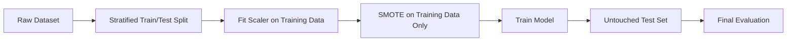

## Reproducible Machine-Learning Results

After auditing the original notebooks, the evaluation pipeline was rebuilt to prevent train/test leakage.

The corrected workflow performs the **train/test split before scaling or SMOTE**, fits preprocessing only on training data, and evaluates models on an untouched stratified holdout set.

### Binary CKD Classification

| Model | Holdout accuracy |
|---|---:|
| **Extra Trees** | **91.57%** |
| Gradient Boosting | **91.27%** |
| Random Forest | **90.66%** |
| XGBoost | **89.16%** |
| Support Vector Machine | **88.55%** |
| AdaBoost | **68.67%** |
| Logistic Regression | **65.66%** |

The strongest model in the corrected experiment was **Extra Trees, achieving 91.57% holdout accuracy**.

This result also showed that model ranking changed after the evaluation pipeline was corrected: XGBoost, which had been emphasized in the original competition workflow, was no longer the highest-performing model.

---

### GFR-Band Classification

The project also explored a more granular task based on numerical GFR ranges.

| Experiment | Clean holdout accuracy |
|---|---:|
| GFR bands without HbA1c | **25.60%** |
| GFR bands with HbA1c | **26.81%** |

Adding HbA1c improved holdout accuracy by only **1.21 percentage points**.

These results indicate that the available features were substantially more useful for **binary CKD classification** than for distinguishing between multiple GFR bands.

The low GFR-band performance is reported intentionally rather than hidden: it demonstrates an important limitation of the current dataset and modeling approach.

---

## Historical vs Corrected Evaluation

The original competition/research workflow reported:

| Task | Original reported result | Cleaned holdout result |
|---|---:|---:|
| Binary CKD classification | 97.61% XGBoost | **91.57% Extra Trees** |
| GFR categories without HbA1c | 38% | **25.60%** |
| GFR categories with HbA1c | 41% | **26.81%** |

During preparation of this public repository, the original notebooks were found to apply **scaling and SMOTE before the train/test split**.

This can introduce data leakage because information from observations that later enter the test set can influence preprocessing and synthetic-sample generation.

The public notebooks therefore use the corrected workflow:

The **cleaned holdout results are the primary reproducible results of this repository**. The original values are retained only to document the development history of the project.

